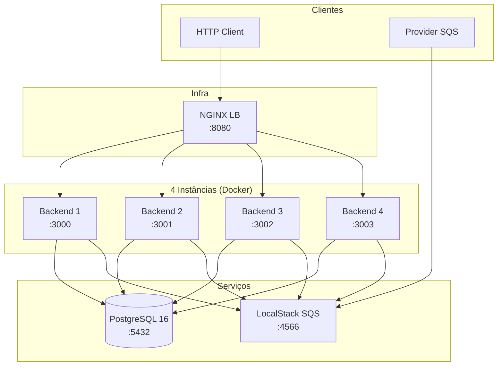
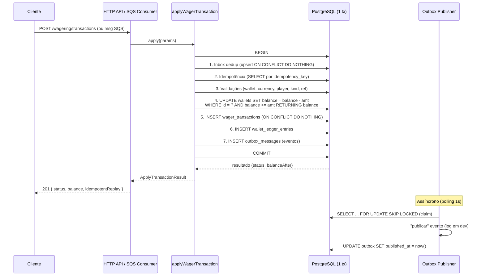

# Arquitetura — Distributed Wagering Processor

Documento de referência das decisões arquiteturais, trade-offs e limitações
do Backend. Complementa o `README.md` (especificação) e o
`DECISIONS.md`.

---

## 1. Visão Geral

O sistema é um **processador de apostas distribuído**.
Recebe transações financeiras (BET, WIN, LOSS, REFUND, ROLLBACK) via HTTP
ou SQS, aplica-as atomicamente ao saldo de wallets, mantém um ledger
imutável auditável, e publica eventos de integração via transactional outbox.

### Princípios

1. **O banco é a fonte de verdade.** Invariantes financeiras (saldo não-negativo,
   ledger imutável, idempotência) são garantidas por constraints e triggers no
   schema, não apenas em código de aplicação (README §5.9).
2. **Atomicidade total.** Saldo, transação, ledger, inbox e outbox são
   persistidos em uma única transação PostgreSQL (README §11).
3. **Correção com múltiplas instâncias.** A solução é correta com 4+ instâncias
   simultâneas — sem lock global, sem estado em memória como garantia (README §5.8).
4. **Idempotência persistente.** Dedup por `idempotency_key` (UNIQUE no banco)
   e `inbox_messages` (UNIQUE por consumer+message). Nunca em memória (README §5.2).
5. **Eventos após commit.** O outbox garante que eventos só são publicados
   após o commit da transação financeira (README §5.4).

---

## 2. Stack

| Camada | Tecnologia | Justificativa |
|--------|-----------|---------------|
| Runtime | **Bun 1.x** | Obrigatório (README §4). Fast, zero-config, `bun test` nativo. |
| Linguagem | **TypeScript strict** | Obrigatório (README §4). Type safety para invariants financeiras. |
| Framework | **NestJS 12** | Obrigatório (README §4). DI, guards, interceptors, lifecycle hooks. |
| ORM | **MikroORM v7** | Preferencial (README §4). `EntityManager.transactional()`, `LockMode`, QueryBuilder com `raw()`. |
| Banco | **PostgreSQL 16** | Obrigatório (README §4). Constraints, triggers, `FOR UPDATE SKIP LOCKED`. |
| Mensageria | **AWS SQS** (LocalStack) | Obrigatório (README §4). FIFO com dedup, DLQ. |
| Orquestração | **Docker Compose** | Obrigatório (README §4). Postgres + LocalStack + 4 backends + NGINX. |
| Migrations | **SQL versionadas** (`migrations/*.sql`) | Obrigatório (README §4). Reversíveis (`*.down.sql`). |

### Por que MikroORM (e não TypeORM)?

Tenho grande experiência com Java/JPA - e a sintaxe do MikroORM me é muito mais familiar.

1. **`EntityManager.transactional()`** — commit/rollback automáticos, sem
   boilerplate de `createQueryRunner()`. O forked EM garante que todas as
   queries dentro do bloco rodam na mesma transação.
2. **`LockMode.PESSIMISTIC_PARTIAL_WRITE`** — mapeia para
   `SELECT ... FOR UPDATE SKIP LOCKED`, essencial para o outbox publisher
   e o pending-reference worker (múltiplos publishers concorrentes).
3. **QueryBuilder com `raw()`** — permite expressões SQL no `UPDATE`
   (ex.: `balance - :amount`) mantendo o escape de parâmetros. Necessário
   para o update atômico do saldo.

### Mapeamento do Money

| Contexto | Representação |
|----------|--------------|
| API HTTP | `{ amount: "25.00", currency: "BRL" }` (string decimal) |
| Domínio (TS) | `Money` class (imutável, `amount: string`, `currency: string`, aritmética `add`/`sub` em string decimal) |
| Banco (PostgreSQL) | `NUMERIC(15,2)` + `CHAR(3)` |
| Entity (MikroORM) | `string` (mapeado de `decimal(15,2)`) |
| Eventos (outbox) | `MoneyProps { amount: "25.00", currency: "BRL" }` (JSON) |

**Nunca** `number`/`float`/`double` — falha eliminatória (README §5.1, §14).
A precisão decimal é garantida pelo `NUMERIC` do PostgreSQL; o TypeScript
trata como string opaca (validação de formato: `^\d+\.\d{2}$`). A aritmética
em TS (`Money.add`/`Money.sub`) é implementada em string decimal (sem float)
e é usada apenas para validações de invariante no domínio (ex.: aritmética do
ledger em `WalletLedgerEntry.create`); a fonte de verdade do saldo continua
sendo o `NUMERIC` do banco.

---

## 3. Arquitetura de Alto Nível



### Componentes por Instância

Cada instância do backend (1 processo Bun) contém:

| Componente | Responsabilidade |
|-----------|-----------------|
| **HTTP API** (NestJS controllers) | Endpoints de wallet, transação, health, reconciliation. |
| **SQS Consumer** (worker) | Polling da fila FIFO, dedup inbox, processamento via use case. |
| **Pending Reference Worker** (worker) | Reprocessamento de transações `PENDING_REFERENCE` com backoff. |
| **Outbox Publisher** (worker) | Publicação de eventos pendentes (`FOR UPDATE SKIP LOCKED`). |
| **AuthGuard** | Validação de tokens (no-op por default; Keycloak OIDC opcional). |
| **Interceptors** | Logging estruturado (JSON) + `X-Instance-Id` + `X-Correlation-Id`. |
| **MetricsCollector** | Métricas em memória (tx por status, duplicatas, retries, DLQ, lock conflicts, outbox lag, latência). |

### Fluxo de uma Transação (hot-path)



---

## 4. Estratégia de Concorrência

### Decisão: Update Atômico Condicionado (sem lock pessimista no hot-path)

A primitiva de concorrência é o **UPDATE condicionado**:

```sql
UPDATE wallets
SET balance = balance - :amount, version = version + 1
WHERE id = :walletId AND balance >= :amount
RETURNING balance
```

**Por que não pessimistic locking (`SELECT FOR UPDATE`)?**

| Critério | UPDATE Atômico | SELECT FOR UPDATE |
|----------|---------------|-------------------|
| Latência | 1 round-trip | 2 round-trips (SELECT + UPDATE) |
| Contenção | Row lock implícito (durante o UPDATE) | Row lock explícito (durante a tx) |
| Deadlock | Impossível (1 statement) | Possível (ordem de locks) |
| Escala | Ótima (Postgres otimiza UPDATE) | Pior (lock retido por mais tempo) |
| Complexidade | Simples | Mais código (retry, timeout) |

O UPDATE atômico é suficiente porque:
- A **unidade de concorrência é a walletId** (README §8).
- O `WHERE balance >= :amount` garante **não-negatividade** no banco.
- `RETURNING balance` retorna o novo saldo (para o ledger).
- `affectedRows === 0` → saldo insuficiente (REJECTED).
- Duas apostas de 80 com saldo 100 → o Postgres serializa os UPDATEs na
  mesma row; um commita com saldo 20, o outro vê saldo 20 < 80 → 0 rows.

**Por que não optimistic locking (version + retry)?**

O `version` é incrementado a cada mudança (auditoria), mas **não** é usado
como guarda de concorrência. O UPDATE atômico já resolve o race sem retry.
O `version` serve para:
- Auditoria (quantas mudanças o saldo sofreu).
- Defesa em profundidade (detectar writes concorrentes inesperados).

### Locks Pessimistas (onde são usados)

`FOR UPDATE SKIP LOCKED` é usado em **dois workers** (não no hot-path):

1. **Outbox Publisher** — claim de eventos pendentes:
   ```sql
   SELECT * FROM outbox_messages
   WHERE published_at IS NULL
   ORDER BY created_at
   LIMIT :batchSize
   FOR UPDATE SKIP LOCKED
   ```
   Múltiplos publishers (4 instâncias) claimam eventos sem bloquear uns
   aos outros. `SKIP LOCKED` ignora linhas já lockadas por outro publisher.

2. **Pending Reference Worker** — claim de transações `PENDING_REFERENCE`:
   ```sql
   SELECT * FROM wager_transactions
   WHERE status = 'PENDING_REFERENCE' AND next_attempt_at <= now()
   ORDER BY next_attempt_at
   LIMIT :batchSize
   FOR UPDATE SKIP LOCKED
   ```

### Múltiplas Instâncias

- **HTTP**: NGINX round-robin. Cada request cai em uma instância; a
  correção é garantida pelo banco (UPDATE atômico), não pela instância.
- **SQS**: Cada instância consome da mesma fila FIFO. O `GroupId` da
  mensagem (walletId) garante ordenação por wallet. A dedup inbox
  (`consumer_name, message_id`) impede processamento duplicado.
- **Outbox**: 4 publishers concorrentes, `SKIP LOCKED` impede double-claim.
- **Pending Reference**: 4 workers concorrentes, `SKIP LOCKED` impede double-claim.

### Cenário Obrigatório (README §8)

Saldo 100.00, duas apostas de 80.00 simultâneas:

1. Instância A: `UPDATE wallets SET balance = balance - 80 WHERE id = W AND balance >= 80` → 1 row, balance = 20.00. COMMIT.
2. Instância B: `UPDATE wallets SET balance = balance - 80 WHERE id = W AND balance >= 80` → 0 rows (saldo 20 < 80). → REJECTED (INSUFFICIENT_BALANCE).
3. Resultado: 1 PROCESSED, 1 REJECTED, saldo 20.00, 1 ledger entry. ✅

---

## 5. Idempotência

### Camadas de Idempotência

| Camada | Mecanismo | Onde |
|--------|-----------|------|
| **HTTP** | `Idempotency-Key` header → `idempotency_key` (UNIQUE no banco) | `wager_transactions` |
| **SQS** | `inbox_messages` (UNIQUE `consumer_name, message_id`) | `inbox_messages` |
| **Provider** | `UNIQUE(provider_id, external_transaction_id)` | `wager_transactions` |

### Fluxo de Idempotência (hot-path)

1. **Inbox dedup** (SQS): `INSERT INTO inbox_messages ... ON CONFLICT DO NOTHING`.
   Se `affectedRows === 0` → mensagem já processada → replay (retorna resultado anterior).
2. **Idempotency key**: `SELECT * FROM wager_transactions WHERE idempotency_key = ?`.
   Se existir → replay (retorna resultado anterior).
3. **Payload hash**: Se a idempotency key existe mas o `payload_hash` difere →
   `IDEMPOTENCY_CONFLICT` (409).
4. **Provider dedup**: `UNIQUE(provider_id, external_transaction_id)` — mesmo
   provider reenviando a mesma transação com idempotency key diferente.

### Por que não em memória?

README §5.2: "Não usar cache em memória como garantia de idempotência."
Com 4 instâncias, um cache em memória não é compartilhado. O banco é a
única fonte de verdade compartilhada.

#### E usar um REDIS ?

Seria perfeitamente possível - e até recomendado para um ambiente real, mas considerando a janela de 3 dias (24h de trabalho) aumentaria a complexidade consumindo tempo precioso de outras partes.

---

## 6. Transactional Outbox

### Problema

Publicar eventos (SNS, Kafka, etc.) **antes** do commit da transação
financeira viola a restrição §5.4. Publicar **depois** do commit cria a
janela: commit OK → processo morre → evento perdido.

### Solução

1. O evento é persistido na tabela `outbox_messages` **dentro da mesma
   transação** que o saldo/ledger/transação.
2. Um worker (Outbox Publisher) faz polling periódico (1s) e publica os
   eventos pendentes (`published_at IS NULL`).
3. Após publicar, marca `published_at = now()`.
4. Múltiplos publishers concorrentes usam `FOR UPDATE SKIP LOCKED`.

### Crash Recovery (README §11)

1. PostgreSQL confirma o commit (transação + outbox).
2. Processo morre antes de publicar.
3. Outra instância (outro publisher) assume: `SELECT ... FOR UPDATE SKIP LOCKED`
   pega o evento pendente.
4. Evento é publicado.
5. Publicação duplicada é idempotente (o consumidor dedup por `eventId`).

### Eventos

| Evento | Quando |
|--------|--------|
| `WagerTransactionProcessed` | Transação aplicada (PROCESSED), inclusive LOSS. |
| `WagerTransactionRejected` | Transação rejeitada por regra de negócio. |
| `WalletBalanceChanged` | Somente quando o saldo muda (BET, WIN, REFUND, ROLLBACK). |
| `WagerTransactionPendingReference` | Referência ausente (REFUND/ROLLBACK sem BET original). |

Envelope: classe abstrata `IntegrationEvent<T>` com `eventId`, `aggregateId`,
`correlationId`, `causationId`, `occurredAt`, `data`. Subclasses concretas
(`WalletBalanceChanged`, etc.) definem `eventType` e `version` no tipo.

---

## 7. Mensageria (SQS)

### Fila

- **Tipo**: FIFO (ordenação por `GroupId` = walletId).
- **Dedup**: `ContentBasedDeduplication=true` (dedup por conteúdo, 5 min).
- **DLQ**: `wager-transactions-dlq.fifo`, redrive após 5 receives.

### Consumer (por instância)

1. `ReceiveMessage` (polling, `WaitTimeSeconds=20` — long polling).
2. Dedup inbox: `INSERT INTO inbox_messages ON CONFLICT DO NOTHING`.
   Se duplicada → ack (DeleteMessage) e retorna resultado anterior.
3. Processa via `applyWagerTransactionUseCase` (mesmo use case do HTTP).
4. **Ack (DeleteMessage) SOMENTE após commit** do use case.
5. Erros de negócio (terminal: WALLET_NOT_FOUND, CURRENCY_MISMATCH, etc.) → ack.
6. Erros transitórios (DB timeout, etc.) → não ack (SQS redelivery).
7. Após 5 tentativas → DLQ (redrive policy do SQS).

### Por que não confiar apenas no FIFO?

README §5.3: "Não confiar apenas em SQS FIFO para garantir consistência."
O FIFO garante **ordenação** por GroupId, mas:
- Não garante **entrega exata uma vez** (at-least-once).
- Não substitui a dedup inbox (5 min de dedup window pode expirar).
- Não garante que o processamento foi bem-sucedido (ack é nosso).

---

## 8. Schema do Banco

### Tabelas

| Tabela | Papel | Invariantes |
|--------|-------|-------------|
| `wallets` | Aggregate root (saldo materializado) | `UNIQUE(player_id, currency)`, `CHECK(balance >= 0)`, `CHECK(version >= 1)` |
| `wager_transactions` | Transações de aposta | `UNIQUE(idempotency_key)`, `UNIQUE(provider_id, external_transaction_id)`, `CHECK(kind IN ...)`, `CHECK(status IN ...)`, `CHECK(amount >= 0)`, `CHECK(REFUND/ROLLBACK → reference NOT NULL)` |
| `wallet_ledger_entries` | Ledger imutável | `UNIQUE(transaction_id)`, `CHECK(direction IN ...)`, `CHECK(amount > 0)`, `CHECK(aritmética)`, triggers bloqueiam UPDATE/DELETE |
| `inbox_messages` | Dedup SQS | `UNIQUE(consumer_name, message_id)` |
| `outbox_messages` | Transactional outbox | Índice parcial `WHERE published_at IS NULL` |

### Triggers

| Trigger | Tabela | Ação |
|---------|--------|------|
| `wallets_set_updated_at` | wallets | `BEFORE UPDATE` → `updated_at = now()` |
| `wager_transactions_protect_terminal` | wager_transactions | `BEFORE UPDATE` → bloqueia transição de estado terminal |
| `ledger_block_update` | wallet_ledger_entries | `BEFORE UPDATE` → `RAISE EXCEPTION` (imutabilidade) |
| `ledger_block_delete` | wallet_ledger_entries | `BEFORE DELETE` → `RAISE EXCEPTION` (imutabilidade) |

### Migrations

- **Up**: `001_tables.sql` → `002_constraints.sql` → `003_triggers.sql` → `004_comments.sql`
- **Down**: `004_comments.down.sql` → `003_triggers.down.sql` → `002_constraints.down.sql` → `001_tables.down.sql`
- Aplicação: `bash scripts/apply-migrations.sh [--down|--reset]`
- No Docker: montado em `/docker-entrypoint-initdb.d/` (apenas no primeiro boot).

---

## 9. Autenticação

### Decisão

**Não implementar autenticação completa** neste desafio. 
O ponto de extensão é **explícito no código**:

- **`AuthGuard`** (`src/api/auth/auth.guard.ts`) — guard global NestJS.
- **`TokenValidator`** (`src/api/auth/token-validator.ts`) — interface para validação.
- **`NoopTokenValidator`** — default (dev/test), sempre permite.
- **`KeycloakTokenValidator`** — OIDC via JWKS (produção), validação RS256.

### Desenho (se ativar)

1. `AUTH_ENABLED=true` + `KEYCLOAK_ISSUER` + `KEYCLOAK_AUDIENCE`.
2. O `AuthModule` injeta `KeycloakTokenValidator` (em vez de `NoopTokenValidator`).
3. O `AuthGuard` extrai o Bearer token, delega ao validator.
4. O validator busca o JWKS do Keycloak (cache 10 min), verifica assinatura RS256,
   valida claims (`iss`, `aud`, `exp`, `iat`, `sub`).
5. A `Identity` (subject, scopes, issuer) é colocada em `request.user`.
6. Rotas abertas: `GET /health/live`, `GET /health/ready` (README §2).

Ver `doc/auth-keycloak.md` para o desenho completo (diagramas, setup, segurança).

---

## 10. Observabilidade

### Logs

- **Formato**: JSON estruturado (1 linha por evento).
- **Campos**: `timestamp`, `level`, `component`, `instanceId`, `correlationId`,
  `messageId`, `transactionId`, `walletId`, `providerId` (quando aplicável).
- **Sem dados sensíveis**: payloads financeiros completos não são logados.
- **Correlation**: `X-Correlation-Id` header (gerado se ausente) propagado
  em toda a request (interceptor).

### Métricas

`MetricsCollector` (singleton por instância):

| Métrica | Descrição |
|---------|-----------|
| `transactionsByStatus` | Contagem por status (PROCESSED, REJECTED, PENDING_REFERENCE, ...) |
| `duplicatesDetected` | Idempotent replays + inbox dedup |
| `retries` | SQS redelivery + pending-reference retries |
| `dlqMessages` | Mensagens enviadas para DLQ |
| `lockConflicts` | Row lock contention no hot-path |
| `outboxLag` | max/avg (ms) entre `occurredAt` e `publishedAt` |
| `processingLatency` | max/avg (ms) por canal (http/sqs) |

Em produção: expor via `/metrics` (Prometheus) ou OpenTelemetry - não realizado nesta etapa.

### Health Checks

| Endpoint | Propósito |
|----------|-----------|
| `GET /health/live` | Liveness: processo está vivo (sempre 200). |
| `GET /health/ready` | Readiness: banco acessível (`SELECT 1`). |

---

## 11. Escala Horizontal

### Modelo

- **1 processo por container** (Bun + NestJS).
- **4 containers** no Docker Compose (escalável para N).
- **NGINX** round-robin para HTTP.
- **SQS** é o load balancer natural para o canal assíncrono.
- **PostgreSQL** é o único estado compartilhado (fonte de verdade).

### Estado em Memória

| Dado | Compartilhado? | Risco |
|------|---------------|-------|
| `MetricsCollector` | Não (por instância) | Baixo (métricas são best-effort) |
| JWKS cache (Keycloak) | Não (por instância) | Baixo (cache, não garantia) |
| Pool de conexões | Não (por instância) | Baixo (max 20 por instância) |
| **Idempotência** | **Sim (banco)** | **Crítico — nunca em memória** |
| **Saldo** | **Sim (banco)** | **Crítico — nunca em memória** |
| **Ledger** | **Sim (banco)** | **Crítico — nunca em memória** |

### Graceful Shutdown

- `SIGTERM` → `OnModuleDestroy` nos workers.
- SQS Consumer: conclui mensagens em andamento ou devolve visibilidade.
- Outbox Publisher: para de claimar novos eventos.
- HTTP: `app.close()` (NestJS) → para de aceitar novas connections.
- Pool de conexões: fechado após os workers pararem.

---

## 12. Limitações e Trade-offs

| # | Limitação | Impacto | Mitigação |
|---|-----------|---------|-----------|
| 1 | **Métricas em memória** (perdidas no restart) | Métricas não persistem entre restarts | Em produção: Prometheus/OTel (opcional) |
| 2 | **Outbox polling** (1s) | Lag de até 1s na publicação de eventos | Ajustar `pollIntervalMs`; em produção: trigger/event |
| 3 | **SQS long polling** (20s) | Latência de até 20s para mensagens novas | Ajustar `WaitTimeSeconds`; em produção: event-driven (SNS → Lambda) |
| 4 | **Sem refresh token** (auth) | Cliente deve obter novo token quando expirar | Fora do escopo (auth não vale pontos) |
| 5 | **Sem suporte a ES256** (auth) | Apenas RS256 (Keycloak default) | Adicionar ES256 no `KeycloakTokenValidator` se necessário |
| 6 | **Sem rate limiting** | Abuso de API não é limitado | Fora do escopo do desafio; em produção: NGINX limit_req ou middleware |
| 7 | **Money como string** (aritmética em string decimal, sem float) | Aritmética em TS é usada apenas para validação de invariantes; o saldo é delegado ao banco (`NUMERIC`) | Correto: o banco é a fonte de verdade; evita bugs de float |
| 8 | **4 instâncias fixas** (Docker Compose) | Escala limitada a 4 em dev | Em produção: Kubernetes/ECS (auto-scaling) |
| 9 | **LocalStack** (SQS em RAM) | Filas somem no restart | Intencional (Postgres é a fonte de verdade) |

---

## 13. Estrutura de Pastas

```
src/
├── main.ts                          # Bootstrap NestJS
├── config/
│   └── env.ts                       # loadEnv() → Env
├── domain/                          # Framework-agnostic (construtor privado + factories)
│   ├── money.ts                     # Money (imutável, string decimal, add/sub)
│   ├── wallet.ts                    # Wallet (aggregate root; open/rehydrate, debit/credit, version)
│   ├── wager-transaction.ts         # WagerTransaction (create/rehydrate, transições de estado)
│   ├── wallet-ledger-entry.ts       # WalletLedgerEntry (imutável; create valida aritmética)
│   ├── inbox-message.ts             # InboxMessage (receive/rehydrate, dedup SQS)
│   ├── outbox-message.ts            # OutboxMessage (enqueue/rehydrate, markPublished/scheduleRetry)
│   ├── enums/                       # WagerTransactionKind, Status, FailureCode, LedgerDirection
│   ├── errors/                      # Domain errors (InvalidMoneyError, LedgerArithmeticError, ...)
│   └── events/                      # IntegrationEvent (abstrata) + subclasses (WalletBalanceChanged, ...)
├── usecases/
│   └── apply-wager-transaction.ts   # Use case (orquestra o hot-path)
├── observability/
│   ├── logger.ts                    # createLogger() → Logger (JSON)
│   ├── app-logger.ts                # @Injectable AppLogger (child per component)
│   └── metrics.ts                   # @Injectable MetricsCollector
├── api/
│   ├── app.module.ts                # AppModule (providers, controllers, workers)
│   ├── tokens.ts                    # DATABASE, SQS_CLIENT, ENV (string tokens)
│   ├── controllers/
│   │   ├── health.controller.ts     # /health/live, /health/ready
│   │   ├── wallets.controller.ts    # /wallets, /wallets/:id, /wallets/:id/ledger, /wallets/:id/reconciliation
│   │   └── transactions.controller.ts  # /wagering/transactions, /wagering/transactions/:id, /providers/:id/...
│   ├── interceptors/
│   │   ├── logging.interceptor.ts   # Logs estruturados (JSON)
│   │   └── instance-id.interceptor.ts  # X-Instance-Id header
│   ├── auth/
│   │   ├── auth.guard.ts            # AuthGuard (global)
│   │   ├── identity.ts              # Identity interface
│   │   ├── token-validator.ts       # TokenValidator interface + AuthError
│   │   ├── noop-token-validator.ts  # NoopTokenValidator (default)
│   │   └── keycloak-token-validator.ts  # KeycloakTokenValidator (OIDC/JWKS)
│   ├── mappers/
│   │   ├── wallet.mapper.ts         # toWalletResponse (entity → DTO HTTP)
│   │   └── transaction.mapper.ts    # toTransactionResponse (entity → DTO HTTP)
│   └── schemas/
│       ├── money.schema.ts          # Zod schema de Money (reutilizado)
│       ├── create-wallet.schema.ts  # Zod schema (POST /wallets)
│       └── submit-transaction.schema.ts  # Zod schema (POST /wagering/transactions)
└── infrastructure/
    ├── database/
    │   ├── db.ts                    # createDatabase() → { orm, em, close() }
    │   ├── apply-wager-transaction.ts  # Hot-path (em.transactional)
    │   ├── entities/                # Shells de persistência (MikroORM)
    │   │   ├── wallet.entity.ts
    │   │   ├── wager-transaction.entity.ts
    │   │   ├── wallet-ledger-entry.entity.ts
    │   │   ├── inbox-message.entity.ts
    │   │   └── outbox-message.entity.ts
    │   └── mappers/                 # entity ↔ domain (toXDomain / toXEntityData)
    │       ├── wallet.mapper.ts
    │       ├── wager-transaction.mapper.ts
    │       ├── wallet-ledger-entry.mapper.ts
    │       ├── inbox-message.mapper.ts
    │       └── outbox-message.mapper.ts
    ├── sqs/
    │   └── sqs-client.ts            # createSqsClient() → SqsClient
    ├── workers/
    │   ├── sqs-consumer.ts          # @Injectable (OnModuleInit/Destroy)
    │   └── pending-reference-worker.ts  # @Injectable (OnModuleInit/Destroy)
    └── outbox/
        └── outbox-publisher.ts      # @Injectable (OnModuleInit/Destroy)
```

---

## 14. Testes

| Tipo | Comando | O que cobre |
|------|---------|-------------|
| **Unidade** | `bun test test/unit` | Money, Wallet, WagerTransaction, WalletLedgerEntry, payload hash, invariants (framework-agnostic) |
| **Integração** | `bun test test/integration` | API HTTP, SQS, outbox, invariants (PostgreSQL real) |
| **Concorrência** | `bun test test/concurrency` | Races reais (paralelismo, não mocks sequenciais) |

**177 testes, 0 falhas** (104 unidade + 59 integração + 14 concorrência).

---

## 15. Teste de stress

```bash
$ ./scripts/init.sh --rebuild
```

```
[17:20:06] rebuildando imagens do backend...
[+] Building 1.3s (22/22) FINISHED
....
0.0s
=> [backend-4] resolving provenance for metadata file                                                                                   0.0s
=> [backend-3] resolving provenance for metadata file                                                                                   0.0s
=> [backend-1] resolving provenance for metadata file                                                                                   0.0s
=> [backend-2] resolving provenance for metadata file                                                                                   0.0s
[+] build 4/4
✔ Image docker-infra-backend-3 Built                                                                                                     1.4s
✔ Image docker-infra-backend-2 Built                                                                                                     1.4s
✔ Image docker-infra-backend-4 Built                                                                                                     1.4s
✔ Image docker-infra-backend-1 Built                                                                                                     1.4s
[17:20:08] imagens rebuildadas
[17:20:08] subindo infraestrutura (PostgreSQL + LocalStack)...
[+] up 8/8
✔ Container wagering-nginx         Running                                                                                               0.0s
✔ Container wagering-localstack    Healthy                                                                                              10.3s
✔ Container wagering-postgres      Healthy                                                                                              10.3s
✔ Container wagering-backend-1     Started                                                                                              13.2s
✔ Container wagering-backend-3     Started                                                                                              13.0s
✔ Container wagering-backend-2     Started                                                                                              13.1s
✔ Container wagering-backend-4     Started                                                                                              13.0s
✔ Container wagering-sqs-bootstrap Exited                                                                                                2.6s
[17:20:21] aguardando PostgreSQL...
[17:20:21]   PostgreSQL pronto
[17:20:21] aguardando LocalStack...
[17:20:21]   LocalStack pronto
[17:20:21] aplicando migrations...
[17:20:21] aguardando PostgreSQL...
[17:20:21]   PostgreSQL pronto
[17:20:21]   aplicando 001_tables.down.sql...
...
[17:20:22]     ✓ 004_comments.sql
[17:20:22]   8 migration(s) aplicada(s)

[17:20:22] validando schema do banco...
[17:20:22]   ✓ Tabelas: 5/5
[17:20:22]   ✓ Constraints: 7/7
[17:20:22]   ✓ Índices: 5/5
[17:20:22]   ✓ Triggers: 4/4
[17:20:22] validando filas SQS...
[17:20:22]   ✓ Fila: wager-transactions.fifo
[17:20:22]   ✓ Fila: wager-transactions-dlq.fifo
[17:20:22] validando backends...
[17:20:22]   ✓ Backend :3000 ready
[17:20:22]   ✓ Backend :3001 ready
[17:20:22]   ✓ Backend :3002 ready
[17:20:22]   ✓ Backend :3003 ready
[17:20:22] ✓ Validação completa: OK
```

```bash
$ cd stress-client && go run ./orchestrator --verbose -report ./stress-test-report.json
```

```
2026-11-06T20:24:19.632Z [INFO] invariant balance_consistency: PASS
2026-11-06T20:24:19.823Z [INFO] invariant no_negative_balance: PASS
2026-11-06T20:24:19.823Z [INFO] orchestrator done: 1 tables, 1004 wallets, 50200 total transactions, 0 errors
```

> **Nota**: o stress-client usa connection pooling (`MaxConnsPerHost: 200`) nos clients HTTP e SQS para evitar esgotamento de portas efêmeras no host. Sem esse limite, ~5.000 goroutines × rajadas de requests criam milhares de conexões TCP novas por segundo, esgotando o range 32768–60999 (28k portas) e causando `connection refused` / `connection reset by peer`. Detalhes em `stress-client/README.md` §5.

```bash
$ ./scripts/stop.sh --volumes
```

```
[16:29:17] parando infraestrutura e apagando volumes (dados serão perdidos)...
[+] down 10/10
 ✔ Container wagering-nginx          Removed                                                                                              0.2s
 ✔ Container wagering-backend-4      Removed                                                                                             10.2s
 ✔ Container wagering-backend-1      Removed                                                                                             10.2s
 ✔ Container wagering-backend-2      Removed                                                                                             10.3s
 ✔ Container wagering-backend-3      Removed                                                                                             10.3s
 ✔ Container wagering-sqs-bootstrap  Removed                                                                                              0.0s
 ✔ Container wagering-postgres       Removed                                                                                              0.2s
 ✔ Container wagering-localstack     Removed                                                                                              5.3s
 ✔ Volume docker-infra_postgres-data Removed                                                                                              0.0s
 ✔ Network docker-infra_default      Removed                                                                                              0.1s
[16:29:33] infraestrutura parada
```

---

## 16. Coisas importantes que ficaram pendentes (para não estourar o limite de 24h do teste):

| Ponto |  Descrição |
|-------|------------|
| **Patterns** | Poderia ter aplicado Strategy Pattern - simplificar o retorno de dados repetitivos |
| **Stress Test** | Reformatação do código, aplicação de DRY, completar a documentação |
| **Stress Test** | Consolidação das métricas, geração de arquivo mermaid/markdown |
| **Testes** | Todos os casos de testes foram escritos por IA e ainda precisam de code-review |

---

## 17. Referências

- `README.md` — especificação do desafio.
- `DECISIONS.md` — decisões da migração para MikroORM.
- `doc/auth-keycloak.md` — desenho da integração com Keycloak.
- `migrations/` — schema (fonte de verdade).
- `docker-infra/docker-compose.yml` — infraestrutura local.
