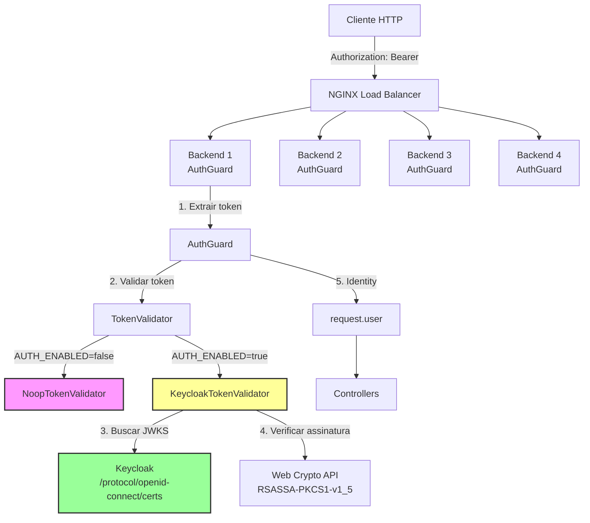
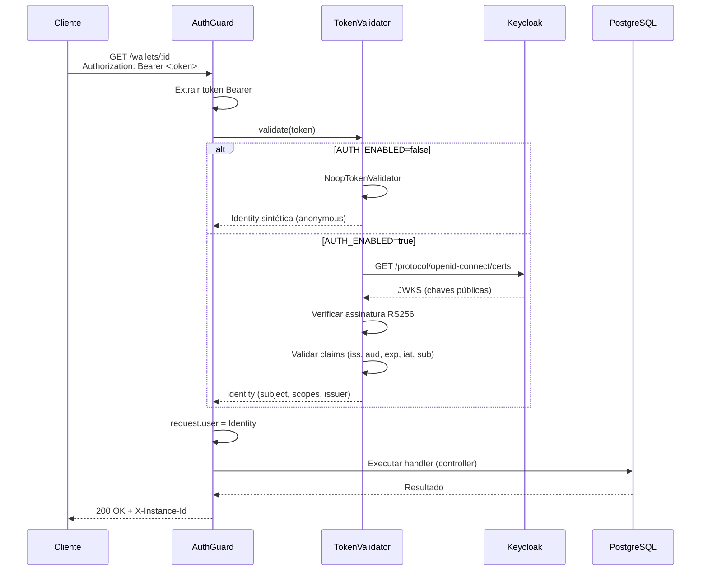

# Autenticação — Integração com Keycloak (OIDC)

Este documento descreve o desenho da integração de autenticação com Keycloak,
conforme exigido pelo README §2.

## Visão Geral

A autenticação é **opcional** no desafio (não vale pontos na avaliação §14),
mas o ponto de extensão deve ser **explícito no código**. Este projeto adota:

- **`AuthGuard`** — guard global NestJS que valida tokens Bearer.
- **`TokenValidator`** — interface para validação de tokens (ponto de extensão).
- **`KeycloakTokenValidator`** — implementação OIDC via JWKS (Keycloak).
- **`NoopTokenValidator`** — validadora no-op para dev/test (default).

A troca entre `Noop` e `Keycloak` é feita via **injeção de dependência**
(controlada pela variável de ambiente `AUTH_ENABLED`).

## Arquitetura



## Fluxo de Autenticação



## Componentes

### 1. `AuthGuard` (`src/api/auth/auth.guard.ts`)

Guard global NestJS que:
1. Extrai o token Bearer da header `Authorization`.
2. Se não houver token:
   - Se a rota é "aberta" (health checks), permitir sem auth.
   - Senão, lançar 401.
3. Se houver token, delegar a validação ao `TokenValidator`.
4. Se válido, colocar a `Identity` em `request.user`.
5. Se inválido, lançar 401.

**Rotas abertas** (sem auth):
- `GET /health/live`
- `GET /health/ready`

### 2. `TokenValidator` (`src/api/auth/token-validator.ts`)

Interface para validação de tokens:

```typescript
interface TokenValidator {
  validate(token: string): Promise<Identity>;
  readonly issuer: string;
}
```

Implementações:
- `NoopTokenValidator` — sempre retorna Identity sintética (dev/test).
- `KeycloakTokenValidator` — valida tokens OIDC via JWKS (produção).

### 3. `KeycloakTokenValidator` (`src/api/auth/keycloak-token-validator.ts`)

Validação de tokens OIDC via Keycloak:

1. **Decodificar header do JWT** — extrair `kid` (key ID) e `alg` (algoritmo).
2. **Buscar JWKS** — `GET {issuer}/protocol/openid-connect/certs` (com cache em memória).
3. **Verificar assinatura** — RS256 com a chave pública correspondente ao `kid`.
4. **Validar claims**:
   - `iss` — deve ser igual ao `KEYCLOAK_ISSUER`.
   - `aud` — deve conter o `KEYCLOAK_AUDIENCE`.
   - `exp` — token não pode estar expirado.
   - `iat` — token não pode ter sido emitido no futuro (clock skew: 5 min).
   - `sub` — deve estar presente e não vazio.
5. **Extrair Identity** — `subject`, `name`, `scopes`, `issuer`, `expiresAt`.

**Cache de JWKS**:
- As chaves públicas são cacheadas em memória por `KEYCLOAK_JWKS_CACHE_TTL_MS` (default: 10 min).
- Se a assinatura falhar (key rotation), o cache é invalidado e o JWKS é re-buscado.

### 4. `NoopTokenValidator` (`src/api/auth/noop-token-validator.ts`)

Validadora no-op para dev/test:
- Sempre retorna uma Identity sintética (`subject: "anonymous"`).
- Usada quando `AUTH_ENABLED=false` (default).

### 5. `Identity` (`src/api/auth/identity.ts`)

Interface para a identidade do principal autenticado:

```typescript
interface Identity {
  subject: string;
  name?: string;
  scopes: string[];
  issuer: string;
  expiresAt: number;
}
```

## Configuração

### Variáveis de Ambiente

| Variável | Default | Descrição |
|----------|---------|-----------|
| `AUTH_ENABLED` | `false` | Habilita autenticação (`true`/`false`). |
| `KEYCLOAK_ISSUER` | `""` | URL do issuer (ex.: `http://localhost:8081/realms/jungle`). |
| `KEYCLOAK_AUDIENCE` | `""` | Audience esperada (ex.: `jungle-api`). |
| `KEYCLOAK_JWKS_CACHE_TTL_MS` | `600000` | TTL do cache JWKS em ms (default: 10 min). |

### Exemplo de Configuração (docker-compose.yml)

```yaml
backend-1:
  environment:
    AUTH_ENABLED: "true"
    KEYCLOAK_ISSUER: "http://localhost:8081/realms/jungle"
    KEYCLOAK_AUDIENCE: "jungle-api"
    KEYCLOAK_JWKS_CACHE_TTL_MS: "600000"
```

## Keycloak Setup

### 1. Subir Keycloak (docker-compose.yml)

```yaml
keycloak:
  image: quay.io/keycloak/keycloak:24.0
  container_name: wagering-keycloak
  command: start-dev
  environment:
    KEYCLOAK_ADMIN: admin
    KEYCLOAK_ADMIN_PASSWORD: admin
  ports:
    - "8081:8080"
  healthcheck:
    test: ["CMD", "curl", "-sf", "http://localhost:8080/health/ready"]
    interval: 10s
    timeout: 5s
    retries: 10
```

### 2. Configurar Realm

1. Acessar `http://localhost:8081` (admin/admin).
2. Criar realm `jungle`.
3. Criar client `jungle-api` (confidential):
   - `Client ID`: `jungle-api`
   - `Access Type`: `confidential`
   - `Valid Redirect URIs`: `*`
   - `Web Origins`: `*`
4. Criar user `test-user` (password: `test`).

### 3. Obter Token

```bash
curl -X POST http://localhost:8081/realms/jungle/protocol/openid-connect/token \
  -d grant_type=password \
  -d client_id=jungle-api \
  -d username=test-user \
  -d password=test
```

Resposta:
```json
{
  "access_token": "eyJhbGciOi...",
  "expires_in": 300,
  "token_type": "Bearer",
  ...
}
```

### 4. Testar API

```bash
# Sem token (deve retornar 401)
curl -i http://localhost:3000/wallets/some-uuid

# Com token (deve retornar 200)
TOKEN="eyJhbGciOi..."
curl -i http://localhost:3000/wallets/some-uuid \
  -H "Authorization: Bearer $TOKEN"
```

## Segurança

### Zero-Trust

- **Nenhum token é aceito sem validação de assinatura.**
- **JWKS é buscado do Keycloak** (não de um endpoint arbitrário).
- **Claims são validados** (`iss`, `aud`, `exp`, `iat`, `sub`).
- **Clock skew** de 5 min é tolerado (para evitar rejeições por drift de relógio).

### Key Rotation

- O Keycloak rotaciona chaves periodicamente (default: a cada 10 anos, mas pode ser configurado).
- O `KeycloakTokenValidator` detecta key rotation:
  1. Se a assinatura falhar com o `kid` cacheado, o cache é invalidado.
  2. O JWKS é re-buscado.
  3. A validação é re-tentada com a nova chave.

### Escopos e Roles

- O `Identity` carrega os `scopes` extraídos do token.
- Os controllers podem usar `@RequireScope("wagering:submit")` (decorator futuro)
  para autorizar ações específicas.
- **Por enquanto**: o guard apenas valida o token; a autorização (scope/role)
  é deixada para um decorator separado (fora do escopo deste desafio).

## Limitações

1. **Sem refresh token** — o cliente deve obter um novo token quando expirar.
2. **Sem cache de tokens** — cada request valida o token (custo: 1 HTTP call ao Keycloak
   a cada 10 min, para o JWKS).
3. **Sem suporte a ES256** — apenas RS256 (o Keycloak usa RS256 por default).
4. **Sem suporte a mTLS** — a comunicação com o Keycloak é via HTTP (em produção,
   usar HTTPS).

## Futuro

- **`@RequireScope` decorator** — autorizar ações por scope/role.
- **`ZitadelTokenValidator`** — suporte a Zitadel (mesma interface `TokenValidator`).
- **Token introspection** — para tokens opacos (não JWT).
- **Rate limiting por user** — baseado no `subject` da Identity.

## Referências

- [Keycloak Documentation](https://www.keycloak.org/docs/latest/)
- [OpenID Connect Core](https://openid.net/specs/openid-connect-core-1_0.html)
- [JSON Web Key (JWK)](https://datatracker.ietf.org/doc/html/rfc7517)
- [JSON Web Token (JWT)](https://datatracker.ietf.org/doc/html/rfc7519)
- [Web Crypto API](https://developer.mozilla.org/en-US/docs/Web/API/Web_Crypto_API)
